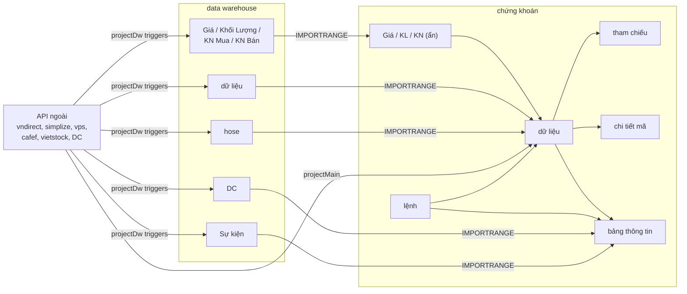

# Mục lục tài liệu các tab Google Sheet

Mỗi tab của hai Google Sheet có một file mô tả riêng, đặt tên đúng bằng tên tab. Nội dung được đọc trực tiếp từ sheet thật qua Sheets API ([`src/offline/sheetsApi.mjs`](../src/offline/sheetsApi.mjs)) ngày 2026-10-12, đối chiếu với code GAS. ID sheet và cách xác minh liên kết: [architecture.md §7](../architecture.md).

## chứng khoán — projectMain (Dashboard)

`1GyxkNiyXantim6R6otooAGd6SLoR4J9Db8nCCx216og`

| Tab | Chức năng |
| --- | --- |
| [bảng thông tin](chứng%20khoán/bảng%20thông%20tin.md) | Tổng quan danh mục: NAV, lãi/lỗ, tỷ trọng, sự kiện, báo cáo quỹ, tin tức, pivot ngành |
| [lệnh](chứng%20khoán/lệnh.md) | Nhật ký lệnh mua/bán năm hiện tại — nguồn của mọi số liệu danh mục |
| [tham chiếu](chứng%20khoán/tham%20chiếu.md) | Bảng quét toàn thị trường, mỗi mã một dòng, kèm thống kê số mã tăng/giảm |
| [chi tiết mã](chứng%20khoán/chi%20tiết%20mã.md) | Tra cứu sâu một mã (gõ mã vào `B1` → onEdit cào dữ liệu) |
| [dữ liệu](chứng%20khoán/dữ%20liệu.md) | Kho trung gian: dữ liệu theo mã, danh mục, vùng đệm cho chi tiết mã |
| [cấu hình](chứng%20khoán/cấu%20hình.md) | Tham số cho công thức và code |
| [vốn](chứng%20khoán/vốn.md) | Sổ nộp/rút tiền, vốn luỹ kế |
| [cổ tức](chứng%20khoán/cổ%20tức.md) | Sổ cổ tức đã nhận, tổng cổ tức trong năm |
| [DC](chứng%20khoán/DC.md) | Danh mục quỹ Dragon Capital (import từ DW) |
| [ghi chú](chứng%20khoán/ghi%20chú.md) | Checklist chọn mã, máy tính margin, ghi chú tự do |
| [debug](chứng%20khoán/debug.md) | Nhật ký lỗi cũ của script |
| [Kiểm toán xấu](chứng%20khoán/Kiểm%20toán%20xấu.md) | Danh sách đen công ty kiểm toán |
| [Sự kiện](chứng%20khoán/Sự%20kiện.md) *(ẩn)* | Lịch sự kiện vĩ mô (import từ DW) |
| [2025](chứng%20khoán/2025.md), [2024](chứng%20khoán/2024.md), [2023](chứng%20khoán/2023.md), [2022](chứng%20khoán/2022.md) *(ẩn)* | Nhật ký lệnh các năm trước |
| [Giá](chứng%20khoán/Giá.md), [Khối Lượng](chứng%20khoán/Khối%20Lượng.md), [KN Mua](chứng%20khoán/KN%20Mua.md), [KN Bán](chứng%20khoán/KN%20Bán.md) *(ẩn)* | Cửa sổ 11–21 phiên cuối của các ma trận bên DW |

## data warehouse — projectDw

`1yttudZqXZD9URweOzEtkRDda-iUiQEh4a2uNmPlKRfw`

| Tab | Chức năng |
| --- | --- |
| [hose](data%20warehouse/hose.md) | Lịch sử VN-INDEX, mới nhất ở dòng 1; cập nhật mỗi phút |
| [dữ liệu](data%20warehouse/dữ%20liệu.md) | Thông tin cơ bản theo mã (P/B, P/E, room, KL TB), ngày đáo hạn phái sinh |
| [Giá](data%20warehouse/Giá.md) | Ma trận giá đóng cửa từ 2013 |
| [Khối Lượng](data%20warehouse/Khối%20Lượng.md) | Ma trận khối lượng từ 2018 |
| [KN Mua](data%20warehouse/KN%20Mua.md) | Ma trận khối ngoại mua từ 2018 |
| [KN Bán](data%20warehouse/KN%20Bán.md) | Ma trận khối ngoại bán từ 2018 |
| [DC](data%20warehouse/DC.md) | Danh mục và báo cáo quỹ Dragon Capital |
| [cấu hình](data%20warehouse/cấu%20hình.md) | Tham số DW, dấu thời gian cập nhật |
| [Sự kiện](data%20warehouse/Sự%20kiện.md) | Lịch sự kiện vĩ mô (`LAY_SU_KIEN()`) |
| [TRUY VAN](data%20warehouse/TRUY%20VAN.md) | Tab nháp phân tích tay |
| [debug](data%20warehouse/debug.md) | Nhật ký lỗi cũ của script |

## Luồng dữ liệu chính

